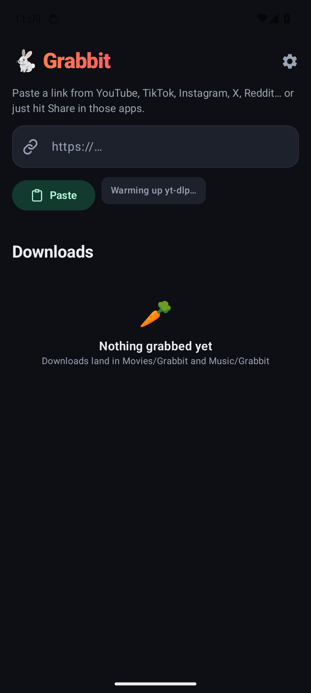
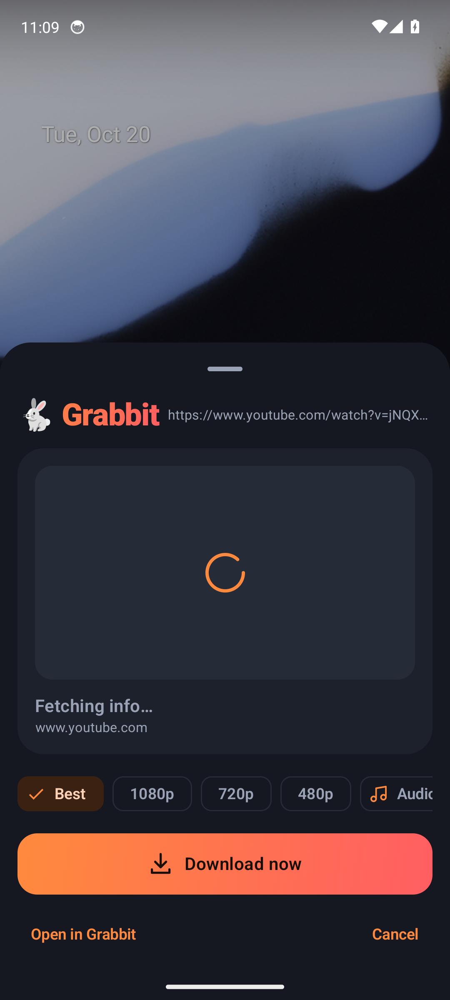
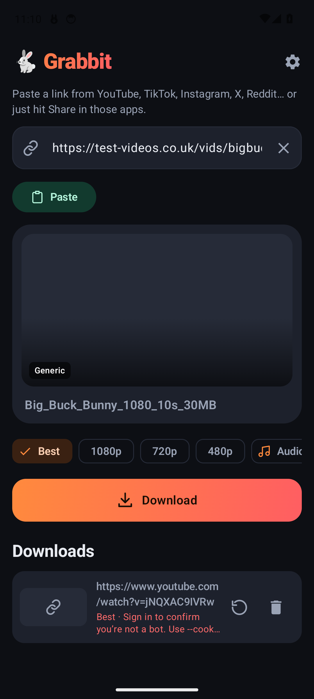
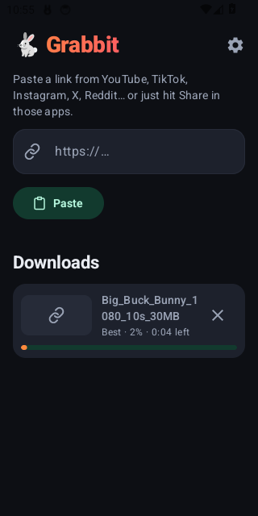
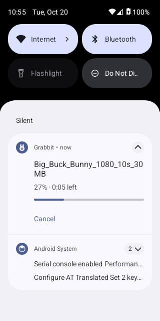
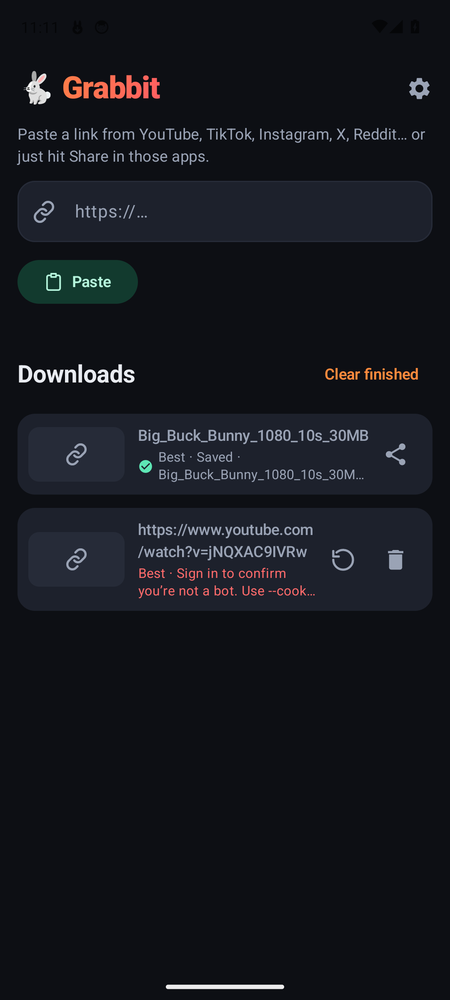

# 🐇 Grabbit

**Share a link, grab the video.** A personal Android video downloader for YouTube, TikTok, Instagram, X, Reddit and the [1,800+ other sites yt-dlp supports](https://github.com/yt-dlp/yt-dlp/blob/master/supportedsites.md).

> 🧪 **Status: v0.2.0.** v0.1.0 ran on a real phone, but YouTube downloads failed with *HTTP Error 403*. 0.2.0 fixes that: the download engine now keeps itself up to date and recovers from 403s. 0.2.0 also adds in-app updates and a CI job that does real downloads from nine sources on every change and once a day ([results](#-real-download-test-matrix)).

---

## ✨ Share first

The quickest way to use Grabbit is to never open it:

1. In YouTube, TikTok, Instagram, X, Reddit or any other app, tap **Share** and pick **Download with Grabbit**.
2. A bottom sheet slides up **over the app you're in**. It shows the title, uploader, duration and thumbnail, with your **default format already selected**.
3. Tap **Download**. The sheet closes and you're back where you were. The download carries on in the background with a progress notification.

**Even fewer taps:** turn on **Settings → Download instantly on share**. Sharing to Grabbit then starts the download straight away with your default format. You get a toast and a notification instead of the sheet.

**Messy share text is fine.** TikTok's `Check out this video! https://vm.tiktok.com/… #fyp`, links spread over several lines, links that only appear in the share subject, and bare `youtu.be/…` links without `https://` all work. Grabbit picks out the video link and ignores tracking or "get the app" links. See [docs/02-share-flow.md](docs/02-share-flow.md).

## 📸 Screenshots

These were captured automatically by the emulator smoke test on GitHub Actions.

| Main screen | Share sheet (over the home screen) | Link preview |
|---|---|---|
|  |  |  |

| Downloading | Progress notification | Saved |
|---|---|---|
|  |  |  |

The test video is *Big Buck Bunny*, © Blender Foundation, licensed CC BY 3.0.

## 📋 Features

- **Share target** (`ACTION_SEND` text/plain). It opens a translucent bottom sheet that's kept out of recents, so you never leave the app you shared from.
- **Download instantly on share** (optional): no sheet, just a toast and a notification.
- **Paste box** with a **Paste** button. When you open the app with a link on your clipboard, Grabbit offers to use it (you can turn this off).
- **Preview first**: title, uploader, duration, site and thumbnail (loaded with Coil).
- **Formats**: **Best** (video and audio merged to MP4), **1080p**, **720p**, **480p**, or **Audio only (MP3)**. The height limits fall back gracefully on sites that don't report a resolution.
- **Download queue** with per-item progress, ETA, merging and converting status, **cancel**, **retry** and **remove**. Up to 2 downloads run at once.
- **Background downloads** use WorkManager as a `dataSync` foreground service. The notification shows progress and has a Cancel button, and you get a "Saved" or "Failed" notification when a download ends.
- **Saved where you'd expect**, through MediaStore, so files show up in your gallery and music apps without any storage permission:
  - video goes to `Movies/Grabbit`
  - MP3 goes to `Music/Grabbit`
  - anything else goes to `Download/Grabbit`

  Tap a finished item to open it, or use the share icon to send it on.
- **Self-updating engine** (see below), with **automatic 403 recovery**.
- **In-app updates** from GitHub Releases, verified before they're installed (see below).
- **Plain-English errors**: for example, *"YouTube blocked this request. Try again later, or update the engine in Settings."* instead of a raw yt-dlp stack.
- **Settings** (saved with DataStore): default format, instant-on-share, clipboard offers, the download engine (version, **Update engine now**, Nightly or Stable, auto-update) and **Check for updates**.
- **Plays everywhere**: at each resolution H.264 is preferred over AV1 (which YouTube now serves first), so saved videos play on phones without an AV1 decoder.
- **Dark Material 3 design** built with Jetpack Compose, with a custom adaptive icon that also has a themed-icon version.

## 🔄 Engine updates (why 0.1.0 got HTTP 403)

yt-dlp is what actually talks to YouTube and the other sites. youtubedl-android 0.18.1 bundles **yt-dlp 2025.11.12** in the APK, which is almost a year old. YouTube keeps changing its player clients, and it now refuses streams handed out to the outdated ones. That's the `unable to download video data: HTTP Error 403: Forbidden` in 0.1.0. yt-dlp has moved on a long way since then: `android_vr` was dropped from the default clients, `web_embedded` fallbacks were added, and the JS challenge solver (EJS) went from 0.3 to 0.8. Grabbit now keeps the engine current:

- **When it updates**: on first launch, once a day in the background (WorkManager, any network), and before a download if the last check was more than 24 hours ago. Updates wait for running downloads to finish, so the engine is never swapped out mid-download.
- **Channel**: **Nightly** by default. That's where yt-dlp ships YouTube fixes first, and it's what the maintainers tell people to use when YouTube breaks. You can switch to **Stable** in Settings, and switching installs that channel straight away.
- **403 recovery**: when a download comes back 403, Grabbit updates the engine and retries. On YouTube it then retries once more with alternate player clients (`android,web_embedded`), which hand out plain stream URLs that don't need a PO token. If it still fails you get a friendly message telling you to update the engine and try again later.
- **JS runtime**: YouTube now needs yt-dlp to solve JavaScript challenges. The library bundles QuickJS and passes it to yt-dlp, and yt-dlp's release zip includes the EJS solver scripts, so updating the engine is all that's needed.
- **Settings → Download engine** shows the version and when it was last checked, plus **Update engine now**, the channel switch and an auto-update toggle.

## 📦 In-app updates (OTA)

- **When it checks**: on launch (at most every 12 hours, release builds only) and from **Settings → Check for updates**. It reads `GET api.github.com/repos/<repo>/releases/latest`, which never returns drafts or pre-releases.
- **The releases repo** is a build setting: `-PupdateRepo=owner/repo`, which becomes `BuildConfig.UPDATE_REPO`. The default is `bently-bot/grabbit`. No token is embedded, so that repo's releases have to be **publicly readable**.
- **"Newer" means** a higher version name. The `versionCode` in `update.json` breaks ties.
- **How it installs**:
  1. Shows the release notes. You can pick **Update**, **Later** or **Skip this version**.
  2. Downloads the APK for the phone's ABI (`grabbit-<ver>-arm64-v8a.apk` and so on) into app cache.
  3. **Checks its SHA-256** against the release's `SHA256SUMS`, and checks it's **signed with the same key** as the installed app.
  4. Hands it to Android's package installer through a `FileProvider` (`REQUEST_INSTALL_PACKAGES`). The first time, Android asks you to allow "Install unknown apps" for Grabbit.
- **Signing**: releases are signed with a permanent release key, which lives only in GitHub Actions secrets plus an offline backup, never in git. Debug and CI builds use throwaway keys, so they can't update to or from a release build.
- **⚠️ Moving from 0.1.0**: 0.1.0 was debug-signed, so Android can't update it in place. **Uninstall it once and install 0.2.0 by hand.** Every update after that installs from inside the app.

## ⚠️ Known limits

- **YouTube sometimes asks for a bot check** (*"Sign in to confirm you're not a bot"*). This happens mostly on datacenter and VPN IP addresses, and often on GitHub Actions runners, so CI reports it as 🚫 blocked rather than a failure. On a normal home or mobile connection it's usually fine. If it happens on your phone, try again later. Grabbit doesn't support cookies or logins.
- **Sites that need a login won't work.** That includes **Vimeo**: current yt-dlp needs an account for vimeo.com pages. It also includes **Reddit** from datacenter IPs, and private Instagram posts.
- The APK is large (see below) because it bundles Python, yt-dlp, FFmpeg and QuickJS.

## 📲 Install

You need **Android 10 or later** (minSdk 29).

1. From the latest [release](../../releases/latest), get **`grabbit-<version>-arm64-v8a.apk`**. Almost every phone from the last several years needs this one. `SHA256SUMS` sits next to it if you want to check the download.
2. Open it on the phone, or install it over USB with `adb install grabbit-0.2.0-arm64-v8a.apk`. Android will ask you to allow installs from that source.
3. Open Grabbit once. It unpacks Python and yt-dlp (a few seconds) and updates the engine in the background. It also asks for permission to show notifications so you can see download progress.
4. Later versions arrive **in the app**. (Coming from 0.1.0? Uninstall it first, see above.)

| Release APK | Size | For |
|---|---|---|
| `grabbit-0.2.0-arm64-v8a.apk` | ~81 MB | almost every modern phone |
| `grabbit-0.2.0-armeabi-v7a.apk` | ~75 MB | old 32-bit phones |
| `grabbit-0.2.0-x86_64.apk` | ~84 MB | emulators / Chromebooks |

CI also builds debug APKs on every push (**Actions → CI → Artifacts**). Those are debug-signed, so they're for testing only and can't take in-app updates.

## 🛠️ Build

You need JDK 17 and the Android SDK (compileSdk 37). Everything else comes from the Gradle wrapper.

```sh
git clone https://github.com/bently-bot/grabbit.git
cd grabbit
./gradlew assembleDebug lint testDebugUnitTest
# APKs: app/build/outputs/apk/debug/app-{arm64-v8a,armeabi-v7a,x86_64}-debug.apk
```

## 🧱 Tech stack

| | |
|---|---|
| Language / UI | Kotlin 2.4, Jetpack Compose (BOM 2026.09), Material 3 |
| Architecture | ViewModel + StateFlow. Packages: `core` (pure logic), `data`, `engine`, `download`, `ui` |
| Download engine | [youtubedl-android](https://github.com/yausername/youtubedl-android) **0.18.1** (bundles Python 3.11, yt-dlp, FFmpeg and QuickJS). yt-dlp self-updates (nightly by default) |
| Background work | WorkManager 2.12 with a foreground service (`dataSync`) |
| Storage | MediaStore for downloaded files, DataStore for settings, a small JSON file for the queue |
| Images | Coil 3 |
| Build | AGP 9.4, Gradle 9.8 wrapper, version catalog (`gradle/libs.versions.toml`), JDK 17, ABI splits |
| Android | minSdk 29, targetSdk 36, compileSdk 37 |

## 🤖 CI, tests and releases

- **CI** (`ci.yml`) runs on every push to `main` and every PR. It runs `assembleDebug`, `lint` and `testDebugUnitTest`, fails if no tests actually ran, and uploads the debug APKs and the lint report as artifacts.
- **Emulator smoke test** (`emulator.yml`) runs on app changes or when started by hand. It uses a KVM-accelerated API 34 emulator on Actions to:
  - launch the app
  - send a messy TikTok-style share intent and check that the sheet appears and closes after **Download**
  - download a public test video and check that it reaches `Movies/Grabbit`

  Screenshots, the queue state and logcat are uploaded as artifacts. Details are in [docs/03-testing.md](docs/03-testing.md).
- **Real downloads** (`real-downloads.yml`) runs on app changes, on PRs and **daily**. It downloads real videos from several sites, both with yt-dlp on the runner and through the app on a KVM emulator. Each saved file is pulled out of MediaStore and checked with `ffprobe`. See the matrix below.
- **Cutting a release**:
  1. Set `appVersionName` in `app/build.gradle.kts`, for example `0.3.0`. The `versionCode` is derived from it (0.3.0 → 3000).
  2. Optionally add notes in `docs/release-notes/0.3.0.md`.
  3. Commit, then run `git tag v0.3.0 && git push origin v0.3.0`.
  4. `release.yml` checks the tag, runs the tests and lint, and builds per-ABI APKs **signed with the release key** (from the `KEYSTORE_BASE64`, `KEYSTORE_PASSWORD`, `KEY_ALIAS` and `KEY_PASSWORD` secrets). It then verifies the signatures, writes `SHA256SUMS` and `update.json`, and **publishes** the release, which phones then pick up as an update.

  Without the signing secrets it only makes a debug-signed **draft**. Tags with a `-` (for example `v0.3.0-beta1`) always stay drafts.

## 🧪 Real-download test matrix

Results from [run 39579072259](../../actions/runs/39579072259) (21 Oct 2026, GitHub-hosted runner, so a datacenter IP). The [Real downloads](../../actions/workflows/real-downloads.yml) workflow refreshes this daily. The full table, with error details, is in each run's summary.

| Source | App on emulator (yt-dlp 2026.10.10 nightly, self-updated) | Host, same yt-dlp | Host, yt-dlp 2025.11.12 (bundled in the APK) |
|---|---|---|---|
| YouTube, short (19 s) | 🚫 bot check | 🚫 bot check | 🚫 bot check |
| YouTube, music video (3.5 min) | ✅ h264 480p | ✅ | ✅ |
| TikTok | ✅ h264 | ❌ (flaky "unexpected response") | ✅ |
| Vimeo | 🚫 login required | 🚫 login required | 🚫 login required |
| Reddit | 🚫 login required | 🚫 login required | 🚫 login required |
| X / Twitter | ✅ h264 | ✅ | ✅ |
| Instagram | ✅ h264 | ✅ | 🚫 rate-limited |
| Dailymotion | ✅ h264 | ✅ | ❌ |
| Plain `.mp4` link | ✅ | ✅ | ✅ |

- ✅ means the file was saved to MediaStore, is non-empty, and `ffprobe` found a valid MP4 with a duration.
- 🚫 means the site refused the runner's IP or wanted a login. That isn't an app failure, and it's never counted as a pass.
- ❌ is any other failure.

The YouTube bot check is the datacenter IP being refused. The 403 from a real phone doesn't happen on runners, but the fix is the same: a current engine.

## 📚 Docs

- [01 · Architecture](docs/01-architecture.md): packages, data flow, download engine, format mapping, storage, APK size
- [02 · The share flow](docs/02-share-flow.md): ShareActivity, instant mode, finding the link in messy share text
- [03 · Testing](docs/03-testing.md): unit tests, the emulator smoke test and the real-download matrix

## ⚖️ Use responsibly

Grabbit is a personal tool. **You're responsible for how you use it.** Respect each site's terms of service and the rights of creators. Only download content you own, have permission to download, or are otherwise legally allowed to save, for example content under a licence that allows it. Don't use Grabbit to redistribute copyrighted material.

## 🙏 Credits

- [yt-dlp](https://github.com/yt-dlp/yt-dlp) does the actual extracting and downloading.
- [youtubedl-android](https://github.com/yausername/youtubedl-android) by yausername, maintained by [JunkFood02](https://github.com/JunkFood02), packages it for Android.
- [FFmpeg](https://ffmpeg.org/) handles merging and MP3 conversion.
